  

### 🌷 About me

- 🐱 I'm **PeiQi**, also known as **Meow** — a frontend developer who loves building cute, polished interfaces.
- 🤖 Currently building **[Piko](https://github.com/Babytiann/Piko)**, an AI assistant for bookkeeping, budgeting and travel.
- 📝 I write about what I learn on my [blog](https://gemdzqq.com).
- 🍀 Continuously improving!

  
  
  

### 💗 Tech stack

### 📊 Stats

  
  

### 🐍 Contributions

<picture>
  <source media="(prefers-color-scheme: dark)" srcset="https://raw.githubusercontent.com/Babytiann/Babytiann/master/profile/snake-dark.svg" />
  <source media="(prefers-color-scheme: light)" srcset="https://raw.githubusercontent.com/Babytiann/Babytiann/master/profile/snake.svg" />
  
</picture>
